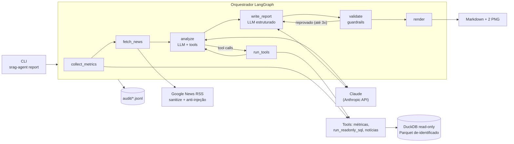

# srag-report-agent

Agente de IA generativa que produz um **relatório automatizado sobre Síndrome Respiratória Aguda
Grave (SRAG)** no Brasil, combinando os dados abertos do Sivep-Gripe (Open DATASUS) com notícias
recentes. Solução do desafio *Artificial Intelligence Engineer Certification* da Indicium.

O relatório traz as quatro métricas pedidas (taxa de aumento de casos, taxa de mortalidade, taxa
de ocupação de UTI e taxa de vacinação), dois gráficos (casos diários nos últimos 30 dias e casos
mensais nos últimos 12 meses), a interpretação de cada número à luz das notícias, e uma seção de
proveniência que explica como tudo foi produzido.

- Exemplo real gerado pelo agente: [`reports/exemplo-2026-11-01.md`](reports/exemplo-2026-11-01.md)
  (com [a trilha de auditoria correspondente](audit/sample-run.jsonl)).
- Diagrama de arquitetura: [`docs/architecture.md`](docs/architecture.md) e [`docs/architecture.pdf`](docs/architecture.pdf).

## Como funciona em uma frase

Um grafo LangGraph calcula as métricas por SQL (sem LLM), busca notícias, deixa o Claude
aprofundar com ferramentas auditadas e redigir o texto em formato estruturado, valida esse texto
com guardrails (inclusive conferindo cada número contra o que as ferramentas devolveram) e só
então renderiza o Markdown com os gráficos.

## Arquitetura



Detalhes de cada componente, do fluxo do grafo e das escolhas em
[`docs/architecture.md`](docs/architecture.md). O PDF exigido na entrega está em
[`docs/architecture.pdf`](docs/architecture.pdf) (gerado por `scripts/render_architecture.py`).

**Stack:** Python 3.13, [uv](https://docs.astral.sh/uv/), LangChain 1.x + LangGraph 1.x,
`langchain-anthropic` (Claude Sonnet 5.5 por padrão), DuckDB, pandas/pyarrow, matplotlib,
httpx + feedparser, pydantic, typer, pytest + ruff.

## Como rodar

Pré-requisitos: Python 3.13, `uv` e uma chave da API da Anthropic.

```bash
uv sync                                   # 1. ambiente e dependências (uv.lock)
cp .env.example .env                      # 2. preencha ANTHROPIC_API_KEY no .env
uv run srag-agent report                  # 3. gera o relatório em reports/
```

Isso basta: o dataset tratado (`data/processed/srag.parquet`, 12 MB, 577 mil casos) está
versionado e o banco DuckDB é reconstruído a partir dele na primeira execução.

Para reproduzir o dataset a partir do Open DATASUS (650 MB de CSV):

```bash
uv run python scripts/download_data.py    # 4. baixa os CSVs de 2025 e 2026 para data/raw/
uv run python scripts/build_dataset.py    # 5. limpa, remove PII, grava Parquet + DuckDB + docs/data-quality.md
```

Outros comandos:

```bash
uv run srag-agent report --reference-date 2026-09-30 --uf SP   # recorte retroativo e por UF
uv run srag-agent report --no-news                             # sem consultar notícias
uv run srag-agent metrics                                      # só as métricas, sem LLM
uv run srag-agent charts                                       # só os gráficos
uv run srag-agent version
```

Saída de `report`: `reports/relatorio-srag-<data>[-UF].md`, dois PNG ao lado e
`audit/run-<timestamp>-<id>.jsonl`. Sem `ANTHROPIC_API_KEY`, o comando roda com um modelo fake
(usado nos testes e na CI) e avisa que o texto não é real.

Variáveis de ambiente (`.env.example`): `ANTHROPIC_API_KEY`, `ANTHROPIC_MODEL`
(`claude-sonnet-5-5`; alternativas `claude-opus-5-5`, `claude-haiku-5-5`), `TAVILY_API_KEY`
(opcional, segunda fonte de notícias). Limites ajustáveis por variável: `MAX_TOOL_CALLS` (8),
`MAX_NEWS_ITEMS` (8), `SQL_ROW_LIMIT` (200), `MAX_WRITE_ATTEMPTS` (3), `MAX_TOTAL_TOKENS` (200000).

## Dados

Fonte: [SRAG 2019 a 2026, Open DATASUS](https://dadosabertos.saude.gov.br/dataset/srag-2019-a-2026)
(o link do enunciado, "SRAG 2021 a 2024", migrou para esse portal; o dataset hoje tem 194
colunas e um arquivo por ano epidemiológico). O projeto usa os bancos vivos de 2025 e 2026,
extração de 02/11/2026, porque o relatório exige os últimos 12 meses.

Fatos medidos que moldaram o pipeline (`data/raw/README.md`, `docs/01-analise-e-decisoes.md`):

- Datas vêm em ISO (`yyyy-mm-ddT00:00:00.000Z`), exceto as doses de vacina covid em `dd/mm/yyyy`; há anos absurdos (8202, 2029) que viram nulo.
- Os arquivos são particionados por ano epidemiológico de `DT_SIN_PRI`, sem sobreposição; a deduplicação por hash da notificação confirma (0 duplicatas).
- As 2 a 3 últimas semanas antes da extração estão subnotificadas e 21% dos casos de 2026 ainda não têm desfecho. Por isso a data de referência padrão é o **último caso do banco** (não "hoje"), os últimos 14 dias são marcados como preliminares nos gráficos e no texto, e a mortalidade usa só casos com desfecho conhecido.

`docs/data-quality.md` é gerado a cada build com linhas lidas, datas inválidas por coluna,
nulos nas colunas-chave e faixas de datas.

## Métricas

Todas usam a data de primeiros sintomas (`DT_SIN_PRI`), uma `reference_date` (padrão: último
caso) e um recorte opcional por UF. Cada `MetricResult` devolve valor, numerador, denominador,
janela, definição em português e ressalvas, que o relatório sempre exibe.

| Métrica | Definição | Ressalva obrigatória |
|---|---|---|
| Taxa de aumento de casos (7 e 30 dias) | casos nos últimos N dias / casos nos N dias anteriores − 1 | os últimos 14 dias são preliminares; a métrica também informa o valor "consolidado" (janelas terminando 14 dias antes do último caso) |
| Taxa de mortalidade | `EVOLUCAO = 2` / `EVOLUCAO ∈ {1, 2, 3}` na janela de 30 dias | exclui casos sem desfecho e informa quantos são; óbitos por outras causas ficam no denominador |
| Taxa de ocupação de UTI (proxy) | `UTI = 1` / `UTI ∈ {1, 2}` entre `HOSPITAL = 1` | não é ocupação de leitos (o Sivep-Gripe não tem capacidade); é a proporção de internados que foram para UTI |
| Taxa de vacinação (proxy) | `VACINA_COV = 1` / `VACINA_COV ∈ {1, 2}` e `VACINA = 1` / `VACINA ∈ {1, 2}` | é a proporção de vacinados entre pacientes com SRAG, não cobertura populacional (viés declarado) |
| Série diária / mensal | casos por dia nos 30 dias até a referência; casos por mês nos 12 meses completos anteriores | períodos preliminares sombreados |

Os valores na execução de exemplo (Brasil, referência 01/11/2026) estão na tabela do
[relatório](reports/exemplo-2026-11-01.md#métricas).

## Governança e transparência

Cada execução grava um JSONL em `audit/` com eventos `run_start`, `tool_call`, `llm_call`
(hash do prompt, tokens, latência, tool calls pedidas), `guardrail` (um por check, com motivo),
`decision` (o modelo explica quais consultas fez e quais notícias usou ou descartou e por quê),
`news_fetch`, `error` e `run_end`. O relatório termina com "Como este relatório foi produzido":
id da execução, hash SHA-256 do Parquet, modelo, tokens, tool calls, guardrails e resultado da
validação. Detalhes em [`docs/governance.md`](docs/governance.md).

## Guardrails

| Camada | O que impede |
|---|---|
| Entrada | UF fora da lista, janelas inválidas, datas futuras (CLI e schemas Pydantic das tools) |
| SQL (`sql_guard`) | mais de um statement, qualquer coisa que não seja `SELECT`, leitura de arquivos, tabelas fora da whitelist, resultados sem `LIMIT`; conexão read-only com acesso a arquivos desligado no motor; timeout |
| Notícias | HTML, textos longos, injeção de prompt (10 padrões pt/en com normalização unicode); conteúdo entregue ao LLM como dado delimitado |
| Saída | estrutura, ressalva obrigatória por métrica, recomendação clínica individual, PII, **consistência numérica** (todo número do texto precisa existir nas métricas, séries, resultados de tools ou títulos de notícias; tolerância 0,1 p.p. / 1 unidade) |
| Orçamentos | `max_tool_calls`, `max_total_tokens`, `max_write_attempts`, limite de recursão, retries com backoff do SDK |

Saída reprovada volta para o redator com o feedback; esgotadas as tentativas, o relatório sai
com um banner "não verificado" e a lista do que não bateu. Tabela completa, com risco, local e
teste de cada guardrail, em [`docs/guardrails.md`](docs/guardrails.md).

## Dados sensíveis

O pipeline carrega só 30 das 194 colunas e descarta explicitamente quase-identificadores (data
de nascimento, raça/cor, etnia, ocupação, gestação, IMC), texto livre, localização abaixo de UF,
lotes de vacina e o número da notificação (substituído por hash truncado). A idade vira faixa
de 10 anos. Um teste garante que nenhuma coluna da lista de privacidade existe no Parquet. O
LLM só recebe agregados; o guardrail de PII é a última barreira no texto. Chaves ficam em
`SecretStr` e nunca aparecem em logs. Detalhes em [`docs/data-privacy.md`](docs/data-privacy.md).

## Testes e qualidade

```bash
uv run pytest                 # 128 testes, sem rede e sem chave (modelo fake, HTTP mockado)
uv run pytest -m live         # smoke test real contra a API (pulado sem chave)
uv run ruff check . && uv run ruff format --check .
```

Cobertura de 92% (`uv run pytest --cov=srag_agent`). Os testes cobrem: limpeza e build do
dataset num CSV sintético (dois formatos de data, anos absurdos, duplicatas, remoção de PII),
métricas num dataset sintético com valores calculados à mão, gráficos, 40 casos de SQL
aceito/rejeitado, fixture real do RSS do Google News com mocks `respx`, casos de injeção
(inclusive evasão por unicode), cada guardrail de saída, e o grafo de ponta a ponta com um
modelo fake roteirizado (tool calls, número inventado → regeneração, falha persistente →
"não verificado", orçamento de tools, recorte por UF). A CI (`.github/workflows/ci.yml`) roda
lint, formatação e testes a cada push.

Convenções de código: módulos pequenos com uma responsabilidade, funções puras onde possível,
tipagem completa, `ruff` (E, F, I, UP, B, SIM) limpo, código e identificadores em inglês,
documentação, prompts e relatório em português.

## Limitações e trabalho futuro

- **UTI e vacinação são proxies** calculados sobre pacientes com SRAG. Ocupação real de leitos exige dados de capacidade (CNES/painéis estaduais) e cobertura vacinal exige o PNI/RNDS; ambos são integrações futuras naturais, como novas tools.
- **Subnotificação recente**: o agente marca e explica, mas não faz *nowcasting*. Um modelo de correção de atraso (como o do InfoGripe) seria o próximo passo.
- **Notícias**: o Google News RSS entrega título, fonte e data, raramente um resumo; o texto das matérias não é lido. Tavily (opcional) traz trechos. Não há verificação de fatos das manchetes, apenas confronto com os números do banco.
- **Sem interface web**: a entrega é CLI + Markdown; uma UI (Streamlit) seria simples de acoplar sobre `run_report`.
- **Custo**: uma execução usa cerca de 30 a 45 mil tokens de entrada e 10 mil de saída no Sonnet 5.5 (3 a 4 chamadas).

## Estrutura do repositório

```
.
├── README.md
├── pyproject.toml / uv.lock / .python-version
├── .env.example                 # ANTHROPIC_API_KEY, ANTHROPIC_MODEL, TAVILY_API_KEY
├── .github/workflows/ci.yml
├── docs/
│   ├── architecture.md / architecture.pdf
│   ├── governance.md / guardrails.md / data-privacy.md
│   ├── data-quality.md          # gerado pelo build
│   ├── 01-analise-e-decisoes.md # análise do enunciado, perfil dos dados, decisões
│   ├── ENUNCIADO-DESAFIO.md
│   └── PROGRESS.md              # diário de construção por fase
├── data/
│   ├── raw/                     # CSVs (gitignored), README com as URLs, dicionário PDF
│   └── processed/srag.parquet   # dataset tratado e de-identificado (versionado)
├── scripts/
│   ├── download_data.py / build_dataset.py / render_architecture.py
├── src/srag_agent/
│   ├── cli.py / config.py
│   ├── data/        schema, cleaning, pipeline, db
│   ├── metrics/     cases, mortality, icu, vaccination, series, collect, models
│   ├── news/        google_news_rss, tavily, sanitize, fetch, models
│   ├── tools/       metrics_tools, sql_tool, news_tool
│   ├── agent/       state, prompts, llm, callbacks, graph, runner
│   ├── guardrails/  sql_guard, injection, numeric_consistency, pii, output_validation
│   ├── audit/       events, logger
│   └── report/      charts, models, render
├── tests/           espelha src; fixtures (CSV sintético, RSS real); dataset sintético
├── reports/         exemplo-2026-11-01.md + PNG (saídas novas são ignoradas pelo Git)
└── audit/           sample-run.jsonl (demais execuções ignoradas pelo Git)
```

## Licença

MIT. Dados: Open DATASUS / Ministério da Saúde (dados abertos). Notícias: links para as fontes
originais via Google News.
