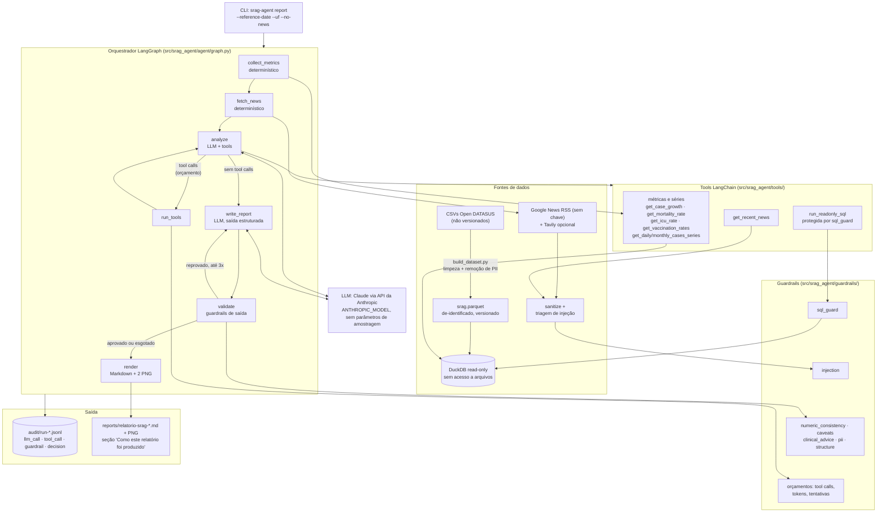

# Arquitetura

O sistema é um agente LangGraph que produz um relatório de SRAG a partir de duas fontes: um banco
DuckDB construído sobre dados de-identificados do Sivep-Gripe (Open DATASUS) e notícias recentes
do Google News. O modelo de linguagem (Claude, via API da Anthropic) **nunca calcula números**:
ele decide quais ferramentas chamar, interpreta os resultados e redige o texto, que passa por
guardrails antes de virar Markdown.

## Diagrama

O PDF deste diagrama está em [`architecture.pdf`](architecture.pdf), gerado por
`uv run python scripts/render_architecture.py`.

## Componentes

| Componente | Onde | Responsabilidade |
|---|---|---|
| CLI | `src/srag_agent/cli.py` | `version`, `metrics`, `charts`, `report`. Valida datas e UF antes de qualquer coisa. |
| Configuração | `src/srag_agent/config.py` | `pydantic-settings`; chaves em `SecretStr`; limites (`max_tool_calls`, `max_news_items`, `sql_row_limit`, `max_write_attempts`, `max_total_tokens`). |
| Pipeline de dados | `scripts/build_dataset.py`, `src/srag_agent/data/` | Lê os CSVs com DuckDB, aplica `cleaning.py` (datas em dois formatos, datas implausíveis, idade em faixas, hash da notificação, dedup), descarta as colunas sensíveis de `schema.PRIVACY_DROPPED_COLUMNS`, grava Parquet zstd e constrói o DuckDB com a tabela `cases` e as views `daily_cases`, `monthly_cases`, `cases_by_uf`. |
| Métricas | `src/srag_agent/metrics/` | Funções puras sobre a conexão: crescimento (7/30 dias, mais o valor consolidado), mortalidade entre desfechos conhecidos, proporção de UTI entre internados, vacinação (covid e gripe) entre pacientes, séries diária e mensal. Cada uma devolve `MetricResult` com numerador, denominador, janela, definição e caveats. |
| Tools | `src/srag_agent/tools/` | Uma tool LangChain por métrica/série (argumentos validados por Pydantic), `run_readonly_sql` protegida por `sql_guard` (só agregados sobre `cases`), `get_recent_news` (devolve as notícias coletadas e, com `query`, busca mais sobre um tema e as acrescenta com novos ids). Toda chamada vira evento `tool_call` com o resultado. |
| Notícias | `src/srag_agent/news/` | Google News RSS (3 consultas em pt-BR, mais as que o agente pedir), Tavily opcional, sanitização (HTML, 600 caracteres), triagem de injeção de prompt em fonte, título e resumo, dedup, ordenação e ids `n1..nN`. |
| Orquestrador | `src/srag_agent/agent/graph.py` | Grafo acima. `GraphContext` carrega conexão, auditoria, modelo e tools; o estado (`AgentState`) carrega métricas, notícias, mensagens, rascunho e validação. |
| LLM | `src/srag_agent/agent/llm.py` | `ChatAnthropic` com modelo, `max_tokens`, timeout e retries (sem `temperature`/`top_p`); saída estruturada com `method="json_schema"`. Sem chave, um modelo fake com respostas roteirizadas (testes e CI). |
| Guardrails | `src/srag_agent/guardrails/` | Ver [`guardrails.md`](guardrails.md). |
| Auditoria | `src/srag_agent/audit/`, `agent/callbacks.py` | JSONL por execução com eventos tipados; callback do LangChain captura cada chamada ao modelo (hash do prompt, tokens, latência, tool calls pedidas). Ver [`governance.md`](governance.md). |
| Relatório | `src/srag_agent/report/` | `charts.py` (matplotlib, zona preliminar sombreada), `models.py` (esquema do texto gerado), `render.py` (Markdown com seção de proveniência). |

## Fluxo de uma execução

1. **`collect_metrics`**: resolve a data de referência (padrão: último `DT_SIN_PRI` do banco) e a UF, calcula as 6 métricas e as 2 séries por SQL. Nenhum LLM envolvido.
2. **`fetch_news`**: busca as 3 consultas no Google News RSS, sanitiza, descarta itens com padrões de injeção (registrando o motivo), deduplica e mantém os `max_news_items` mais recentes.
3. **`analyze`**: o modelo recebe as métricas em JSON, as séries e as notícias entre delimitadores `<noticia id=...>`, com instrução explícita de tratá-las como dado. Pode chamar tools para aprofundar (ex.: crescimento por UF, SQL agregado por faixa etária, busca de notícias sobre uma UF citada) dentro de `max_tool_calls`; cada rodada volta a `analyze` e o modelo explica antes o que vai consultar. Esgotado o orçamento, as ferramentas ficam declaradas mas desligadas (`tool_choice: none`). Ao final, descreve em texto as decisões tomadas (quais notícias usou e por quê) e os achados com os números exatos, tudo registrado como evento `decision`.
4. **`write_report`**: o modelo preenche o esquema `ReportContent` (resumo, uma seção por métrica, aprofundamento, contexto de notícias com citações, limitações) usando a saída estruturada nativa.
5. **`validate`**: estrutura, caveats obrigatórios, recomendação clínica, PII e consistência numérica contra tudo que as tools devolveram. Se reprova, o feedback volta para `write_report` (até 3 tentativas); depois disso o relatório sai marcado como **não verificado**.
6. **`render`**: gera os dois PNG e o Markdown com a seção "Como este relatório foi produzido" (hash do Parquet, modelo, tokens, tool calls, guardrails e resultado).

## Por que essas escolhas

- **Métricas fora do LLM**: números reproduzíveis e testáveis; o modelo só interpreta. O guardrail numérico garante que nada no texto saia do que as tools devolveram.
- **Data de referência = último caso, com valor consolidado ao lado**: a variação bruta dos últimos dias é dominada pelo atraso de notificação. Em vez de esconder isso, a tabela mostra o valor bruto e o consolidado (janelas terminando 14 dias antes) e o texto é obrigado a explicar a diferença. Um *nowcasting* seria o próximo passo, não um padrão silencioso.
- **DuckDB em arquivo + Parquet versionado**: zero infraestrutura; `uv run srag-agent report` funciona num clone limpo porque o banco é reconstruído do Parquet quando falta.
- **Google News RSS**: notícias em tempo real sem chave de API; o avaliador só precisa da chave da Anthropic.
- **Grafo explícito em vez de agente ReAct pronto**: orçamento, auditoria e retry visíveis como nós e arestas.
- **Saída estruturada + guardrails próprios**: cada regra é código pequeno, com teste, explicável no README.
