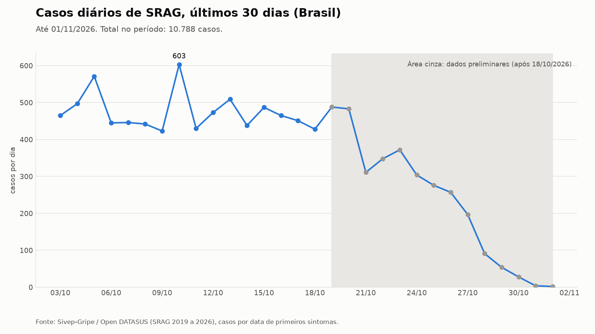
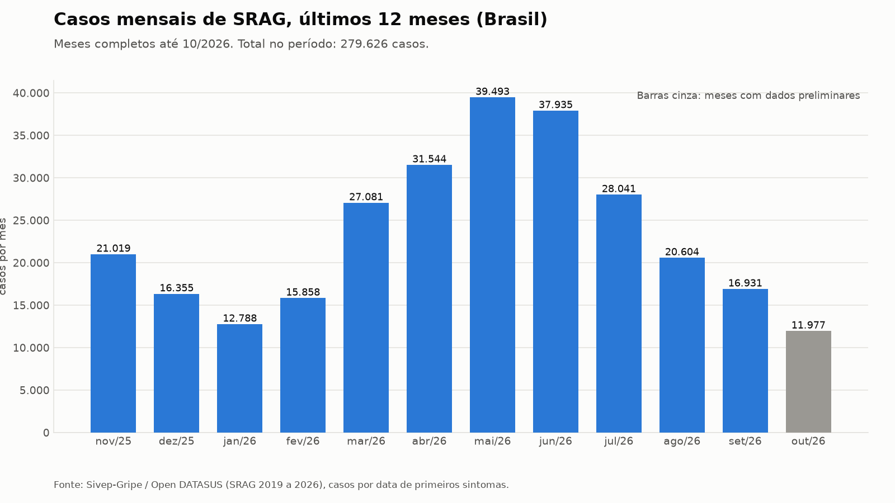

# Relatório de SRAG: Brasil, referência 01/11/2026

Síndrome Respiratória Aguda Grave (Sivep-Gripe / Open DATASUS). Métricas calculadas por código; interpretação redigida por um modelo de linguagem a partir exclusivamente desses números e validada por guardrails.

## Resumo executivo

Os indicadores de SRAG no Brasil com referência em 01/11/2026 mostram queda aparente de -75,5% em 7 dias (633 casos contra 2582) e de -35,5% em 30 dias (10788 contra 16734). Boa parte dessa queda vem do atraso de notificação, porque os últimos 14 dias são preliminares. Sobre dados consolidados, a variação é de -3,2% em 7 dias (3251 contra 3360 casos) e de -14,3% em 30 dias (15451 contra 18023). A mortalidade entre casos com desfecho conhecido é de 4,1% (191 de 4636), mas 57,0% dos casos da janela (6152 de 10788) ainda não têm desfecho registrado. Entre os internados com informação, 28,8% foram para UTI (2625 de 9114), o que não equivale à ocupação de leitos. A vacinação entre pacientes com SRAG é de 39,1% para covid-19 (4164 de 10662) e de 39,6% para gripe (4021 de 10157), sem representar cobertura populacional. A análise adicional indica concentração de casos em crianças de 0 a 9 anos e de óbitos em idosos, e uma grande parcela de casos sem etiologia definida.

## Métricas

| Métrica | Valor | Numerador / denominador | Janela |
|---|---:|---:|---|
| Taxa de aumento de casos (7 dias) | **-75,5%** | 633 / 2.582 | 26/10/2026 a 01/11/2026 |
| Taxa de aumento de casos (30 dias) | **-35,5%** | 10.788 / 16.734 | 03/10/2026 a 01/11/2026 |
| Taxa de mortalidade (casos com desfecho conhecido) | **4,1%** | 191 / 4.636 | 03/10/2026 a 01/11/2026 |
| Taxa de ocupação de UTI (proxy: internados que foram para UTI) | **28,8%** | 2.625 / 9.114 | 03/10/2026 a 01/11/2026 |
| Taxa de vacinação contra covid-19 entre casos de SRAG (proxy) | **39,1%** | 4.164 / 10.662 | 03/10/2026 a 01/11/2026 |
| Taxa de vacinação contra gripe entre casos de SRAG (proxy) | **39,6%** | 4.021 / 10.157 | 03/10/2026 a 01/11/2026 |

## Gráficos

## Interpretação por métrica

### Taxa de aumento de casos (7 dias)

**A variação de casos em 7 dias é de -75,5% (633 casos contra 2582), valor preliminar que superestima a queda.**

A janela de 26/10 a 01/11/2026 teve 633 casos de SRAG, contra 2582 na janela de 19/10 a 25/10. Os últimos 14 dias são preliminares por atraso de notificação, o que faz o período recente parecer uma queda. Sobre dados consolidados (janela terminando em 18/10/2026), a variação é de -3,2%, com 3251 casos contra 3360. A contagem usa a data de primeiros sintomas, não a de notificação.

*Definição:* Casos de SRAG com primeiros sintomas entre 26/10/2026 e 01/11/2026 (633) divididos pelos casos entre 19/10/2026 e 25/10/2026 (2582), menos 1 no Brasil.

*Ressalvas:*
- Os últimos 14 dias antes de 01/11/2026 são preliminares: o atraso de notificação faz o período recente parecer uma queda.
- Sobre dados consolidados (janela de 7 dias terminando em 18/10/2026: 3251 casos contra 3360 na janela anterior) a variação é -3,2%.
- Contagem por data de primeiros sintomas, não por data de notificação.

### Taxa de aumento de casos (30 dias)

**A variação de casos em 30 dias é de -35,5% (10788 casos contra 16734), com forte efeito de notificação incompleta.**

Foram 10788 casos com primeiros sintomas entre 03/10 e 01/11/2026, contra 16734 entre 03/09 e 02/10. Como os últimos 14 dias são preliminares, a queda recente é em parte artefato do atraso de notificação. Sobre dados consolidados (janela de 30 dias terminando em 18/10/2026), a variação é de -14,3%, com 15451 casos contra 18023. A série mensal indica tendência de queda desde o pico de maio/2026, que teve 39493 casos. Outubro soma 11977 casos, valor preliminar.

*Definição:* Casos de SRAG com primeiros sintomas entre 03/10/2026 e 01/11/2026 (10788) divididos pelos casos entre 03/09/2026 e 02/10/2026 (16734), menos 1 no Brasil.

*Ressalvas:*
- Os últimos 14 dias antes de 01/11/2026 são preliminares: o atraso de notificação faz o período recente parecer uma queda.
- Sobre dados consolidados (janela de 30 dias terminando em 18/10/2026: 15451 casos contra 18023 na janela anterior) a variação é -14,3%.
- Contagem por data de primeiros sintomas, não por data de notificação.

### Taxa de mortalidade (casos com desfecho conhecido)

**A mortalidade entre casos com desfecho conhecido é de 4,1% (191 óbitos por SRAG em 4636 casos).**

O denominador inclui apenas casos com desfecho conhecido (cura, óbito por SRAG ou por outras causas). Ficaram de fora 6152 de 10788 casos da janela (57,0%), ainda sem desfecho registrado, então o valor tende a ser revisado. Óbitos por outras causas entram no denominador, mas não no numerador. A leitura deve ser cautelosa, sobretudo para casos recentes.

*Definição:* Óbitos por SRAG (EVOLUCAO=2, 191) divididos pelos casos com desfecho conhecido (cura, óbito por SRAG ou por outras causas, 4636) entre 03/10/2026 e 01/11/2026 no Brasil.

*Ressalvas:*
- 6152 de 10788 casos da janela (57,0%) ainda não têm desfecho registrado e ficaram fora do denominador; a mortalidade recente tende a ser revisada.
- Óbitos por outras causas (EVOLUCAO=3) contam no denominador, não no numerador.

### Taxa de ocupação de UTI (proxy: internados que foram para UTI)

**Entre os internados com informação de UTI, 28,8% foram admitidos em UTI (2625 de 9114).**

A métrica é a proporção de internados por SRAG que precisaram de UTI. Não mede ocupação de leitos, pois o Sivep-Gripe não informa a capacidade instalada. Ficaram fora do denominador 1095 internados sem informação de UTI, o que pode afetar a estimativa. A janela é de 03/10 a 01/11/2026 e inclui dados preliminares.

*Definição:* Internados por SRAG admitidos em UTI (UTI=1, 2625) divididos pelos internados com informação de UTI (UTI=1 ou 2, 9114) entre 03/10/2026 e 01/11/2026 no Brasil.

*Ressalvas:*
- Não é ocupação de leitos: o Sivep-Gripe não informa capacidade de UTI. A métrica é a proporção de internados por SRAG que precisaram de UTI.
- 1095 internados sem informação de UTI ficaram fora do denominador.

### Taxa de vacinação contra covid-19 entre casos de SRAG (proxy)

**Entre os casos de SRAG com informação vacinal, 39,1% tinham vacina contra covid-19 registrada (4164 de 10662).**

O valor é a proporção de vacinados entre pacientes com SRAG, não a cobertura vacinal da população. Pacientes graves tendem a ser menos vacinados, então o número subestima a cobertura populacional, que depende de fonte própria (PNI/RNDS), fora do escopo deste conjunto de dados. Ficaram de fora do denominador 126 casos sem informação vacinal.

*Definição:* Casos de SRAG com vacina contra covid-19 registrada (VACINA_COV=1, 4164) divididos pelos casos com informação vacinal (VACINA_COV=1 ou 2, 10662) entre 03/10/2026 e 01/11/2026 no Brasil.

*Ressalvas:*
- É a proporção de vacinados entre pacientes com SRAG, não a cobertura vacinal da população. Pacientes graves tendem a ser menos vacinados, então o valor subestima a cobertura populacional (fonte própria: PNI/RNDS, fora do escopo deste dataset).
- 126 casos sem informação vacinal ficaram fora do denominador.

### Taxa de vacinação contra gripe entre casos de SRAG (proxy)

**Entre os casos de SRAG com informação vacinal, 39,6% tinham vacina contra gripe na última campanha (4021 de 10157).**

O valor é a proporção de vacinados entre pacientes com SRAG, não a cobertura vacinal da população. Pacientes graves tendem a ser menos vacinados, então o número subestima a cobertura populacional, que depende de fonte própria (PNI/RNDS), fora do escopo deste conjunto de dados. Ficaram de fora do denominador 631 casos sem informação vacinal, uma lacuna maior que a da vacina contra covid-19.

*Definição:* Casos de SRAG com vacina contra gripe na última campanha registrada (VACINA=1, 4021) divididos pelos casos com informação vacinal (VACINA=1 ou 2, 10157) entre 03/10/2026 e 01/11/2026 no Brasil.

*Ressalvas:*
- É a proporção de vacinados entre pacientes com SRAG, não a cobertura vacinal da população. Pacientes graves tendem a ser menos vacinados, então o valor subestima a cobertura populacional (fonte própria: PNI/RNDS, fora do escopo deste dataset).
- 631 casos sem informação vacinal ficaram fora do denominador.

## Aprofundamento

Os recortes abaixo usam a janela consolidada de 19/09 a 18/10/2026, para reduzir o viés do atraso de notificação. Por UF, Sergipe teve 287 casos contra 261 na janela anterior (+10,0%), aumento moderado sobre número absoluto pequeno. Mato Grosso do Sul teve 408 casos contra 514 (-20,6%), ou seja, queda consolidada. As UFs com mais casos na janela foram SP (3472), PR (1668), MG (1614), RJ (1237), RS (1218), SC (1025), BA (616) e CE (474). Pela classificação final, 6466 casos estão como não especificado, 4299 como outro vírus respiratório, 3572 com classificação em branco, 563 como influenza, 348 como covid-19 e 203 como outro agente. Uma parte grande dos casos ainda não tem etiologia definida, há predominância de outros vírus respiratórios e influenza e covid-19 têm peso pequeno. Por faixa etária, 0-9 anos concentra de longe mais casos (9594 casos, 56 óbitos, 6355 com desfecho). Os óbitos se concentram nos idosos: 80+ com 119 óbitos (1308 casos, 775 com desfecho), 70-79 com 85 óbitos (1090 casos, 607 com desfecho) e 60-69 com 70 óbitos (965 casos, 534 com desfecho). Os demais grupos foram 10-19 (721 casos, 13 óbitos), 50-59 (572 casos, 38 óbitos), 40-49 (499 casos, 20 óbitos), 30-39 (399 casos, 14 óbitos) e 20-29 (302 casos, 11 óbitos); há ainda 1 caso sem faixa etária informada. Não foram calculadas taxas por faixa etária, pois nenhuma ferramenta as forneceu.

## Contexto das notícias

As notícias são dados externos não verificados e servem apenas como contexto, sem atribuição de números além dos que constam nos títulos. Os alertas para Sergipe [n1] [n6] são coerentes com o aumento moderado observado no banco para a UF (+10,0% na janela consolidada), embora o número absoluto seja pequeno (287 casos). As notícias sobre cinco estados em risco ou com alta de casos graves [n5] [n8], incluindo Mato Grosso do Sul [n7], divergem do banco, que mostra queda consolidada de -20,6% em MS. Os critérios provavelmente diferem, mas isso não pode ser confirmado com os dados disponíveis. A notícia sobre Uberaba [n2] é um exemplo local, com 20 mortes e 694 hospitalizações em 2026 segundo o título, e não é comparável ao recorte nacional. Notícias sobre um caso individual foram desconsideradas, por não informarem tendência populacional.

| Id | Data | Fonte | Título | Citada |
|---|---|---|---|:---:|
| n1 | 05/11/2026 | G1 | [Casos de Síndrome Respiratória Aguda Grave em Sergipe estão em nível de alerta, aponta InfoGripe](https://news.google.com/rss/articles/CBMijwFBVV95cUxNdkRIWjlIV2dYMkFuaGpMeDkzcHcwMU5zYXdtbkVHZzNickZLMEQxQnh4NTNTT2J1cF9vSnNZcjlVNURKeFNWLUJJQmN0eHREWUdsREdFWk5uRjhoOHhfbUxNSC1EWlpwWmpMbThwUk9XdFF6aWJTelVxeG5WdTZMYTMxMTFHWTY2SjZCYVlrb9IBngFBVV95cUxOeG8tbUV2N2hvMmNqRjBDRkp1LWpXRGdTYW5OQURxU2tjRE11TVJmVmVLZUN5M2RwYlpmMUNkbHVENERDdEtQNXlSXzJqSkZuWXRKTlBiUFlWa3VwcFRtVmRacjFpOEo1bHZHdWhKUnJuWGRORklJMGpWV294OWdaaW5YS3RhVnFXejRmUWhHUmdZUDh3dS1WRmNQMW50Zw?oc=5) | sim |
| n2 | 05/11/2026 | JM Online | [Uberaba chega a 20 mortes por SRAG e soma 694 hospitalizações em 2026](https://news.google.com/rss/articles/CBMirgFBVV95cUxOZW5hbGw4c3JtWjdNcldQcGhic3pYbXUyaTFqRVQydFhkeGxISktWRl8wd2FvUzFIM1A5RF93OEloS1VjMDJiUFhodDFmWjRhaDd3V0EyWU0yUGF0b2pjMk5XTWROc2QxSDRTM1NUSlNZMWNvdEtkMk5UNC13cWJJR2FFTDFtd3FZZ3dqQ3BZVERMaTRkcGtGTDJPODNTNHlIX3hSWWxUNDc3RnJoc3fSAbYBQVVfeXFMT19TN3VsUHB3Nnl4X21iYW5YZVFjUG1IZk1ESUwxQ1NvdkJxaVNZeXRjMVNxc1l4NUx1U2pGaldjcmxSOGxqUkhoS1JnUmNRa2t4WmJ3M19xaWdfeGNoTnI0cVd4WmV6YkJmMElqWUxuRzlZdTFNeDNYVWdCdjJPZkx6Snd1aGp3QlNfR3ZidDM4a0VsVVdSVUQ2TDU2ZlhDUUV1YnJVbUJZdHkyMVBvVlJmTkZtUXc?oc=5) | sim |
| n3 | 03/11/2026 | AM POST | [Bebê indígena de cinco meses é resgatado de helicóptero após quadro grave na Terra Yanomami](https://news.google.com/rss/articles/CBMivwFBVV95cUxOcGdyVHBLcnRvTy1JRnowbW04LV9CSFBHbVQwZk1HR0VKYTRrY05Gb1RoMjVjQ3VWOE84VWtENzFud3V0SFZuaGJFUmtKeElDa2k2LUd0amdHQzYwTl9idFZPVmt5SVRrT1Q5NlVIeXlqNHhFamxFWTZkc0RuV0FhRnpYTGNEdWdxOEcxVXF2bVVmcEZRQTl4RjFjQXRiclFnV1k1elRJQnh2NnVxM3dqbDQ5MzlpMVl3YTd5bUttaw?oc=5) |  |
| n4 | 02/11/2026 | Folha BV | [Bebê de cinco meses é resgatado de comunidade Yanomami após diagnóstico de síndrome respiratória grave](https://news.google.com/rss/articles/CBMi1wFBVV95cUxOMlZhNDhFai14WFZWT0Uzbll5MEY1YlloMkY4Zk9FNDhLY25MWmUxaEdsR1hTbVFoSFRVQ05RSjY5S1I5cmpPVUdSUmVGUHpSRWF2YmIzYkNCczRLWHBWUDVvaHRlUjhSWnNQMldweGdNZElLbVJ2NVpzTDJ4cXdHNm1kcHg4RTByeUtzX04wbGhtN1VEWE9OdDFETEtxZVBENGdoUlQ1QnVmbXBlNmgwUUprcXZFNnlQUUhRcTFhdXJhVG5qR1R3VGNjNllVek9rN0d4OUFqNA?oc=5) |  |
| n5 | 30/10/2026 | CNN Brasil | [Cinco estados do Brasil estão em nível de risco para síndrome respiratória](https://news.google.com/rss/articles/CBMirwFBVV95cUxOM1RyRk9BNUQ0aERoaFVNd1JXaHFCVVJrZmJvdTZPaXNBVHdWa0N2M0U1cmEya1NESFF5SEpncU5iRlJnUzBnUlh4N2kwR1V2U0Z0RkhHWTFLQTctejVQM0x4c2g5VTFYYU9CU05TMm9HemxXMlk4TEZhdFFnNGV5S0RKOHJUOTUydFd2eURsMFI3Sl9vaEhkcHBnUWphRjN2YkZjQlJrNkVxaTQ5a2d3?oc=5) | sim |
| n6 | 30/10/2026 | sergipenoticias.com | [Sergipe em alerta para Síndrome Respiratória aguda e Aracaju entre capitais com maior atenção](https://news.google.com/rss/articles/CBMiuAFBVV95cUxPOG04UGREbW5OZElTbHg1OFhONndoSExRcFI3QWJSdXJRZ25uQTctaUhYT0dUSlB1WEZfZ1FHT1VJZUd3Zm9Tcms1NUdQRnFiZ2x1MExJbVh4V2xKQmVDNmhMTFh6eFhKLTRZR2FTcnE5RzBTM0laMWhHNzNCQmNYUmZ6VVRsSUtiMEFWZ3lyNzQ5TExRczJOOEZMbWU2d1RHbnVORVduQnZWalhCYlFvMUx6aUNYZk9D?oc=5) | sim |
| n7 | 29/10/2026 | Campo Grande News | [MS está entre 5 estados com alta de casos graves de SRAG](https://news.google.com/rss/articles/CBMivgFBVV95cUxOSEhiTWlKMXVhaFhuSS1UZzgxWFFHRTE1LU5pSnpzVnp3Um9vNGF5ZVVGUnFmbXE5bjZWcS1ocDVLaU9qTm93d1JmSVBtWERSYlgyUHZmWjFXRVBieVZhUTdKdjFDdWlQVmxROGprZGxQNDBfeVdEZWtURWhFSnNYM0tVUXhDdzI3N3c5QWRiTzRpczc5eDdyVENrV1pCOFhuc0ZUd3p1ZEEtS0t5UlVueklVOHNTVGJSTHExbGNn0gG-AUFVX3lxTE12UEh2bXJVYlA0RURSSC1DMENueGFBaHNsbmJGVm1DZ2pYQWdVRGFLdmpkZC1qMnVxRjN1X3V2MU9uTjN2TnZtTzJoek0yNE14UjBHUVBzd1JIRXFWT1ZpWVl0bkdSdzJKWTA4VWZMcTlBZXpYNHFRcmlMWm5DWGZMVDZSSWktdzB4Y0FrNDlHdUxfczZtR2MxRWR0STN4MXFpNUEyS2xsYjFGbjBWSjBiTUVkUUVSSlU4MEV6alE?oc=5) | sim |
| n8 | 29/10/2026 | UOL Notícias | [Cinco estados registram alta de casos de doenças respiratórias graves](https://news.google.com/rss/articles/CBMi1gFBVV95cUxQdkdrLUFfbV9jbGxBeDZCWE5QLV8xdkNESy1meDFqbjVYckRtcXNJYjBBZW1NTFN1ZDhtM0p3b0x1M3Qtd1hKUmNGN1Nlc2NSa0w5RVFXV2ZjbzREb2JWd0xMMms4bXphOUFWeXd4RXVwUkVWdEtNbWphSXdrTVpZVVFWSklCRUZ3QU5jV21aZ3ZlaVBYS3czUE40OThCc3RxdS1ZejRCSUVJYkJ4dDlQenV2Vl9DdWNvWlJWWDhmR01kWXAyYS04NmhRb1I0UmMwaEtzSGJn?oc=5) | sim |

## Limitações

- Os últimos 14 dias antes de 01/11/2026 são preliminares por atraso de notificação, e as variações de 7 e 30 dias sobre dados não consolidados superestimam a queda.
- A contagem de casos usa a data de primeiros sintomas, não a de notificação.
- A mortalidade considera apenas casos com desfecho conhecido; 6152 de 10788 casos (57,0%) estão sem desfecho e o valor tende a ser revisado.
- A taxa de UTI é a proporção de internados que foram para UTI, não a ocupação de leitos, e 1095 internados sem informação de UTI ficaram fora do denominador.
- A vacinação é medida entre pacientes com SRAG, não é cobertura populacional e tende a subestimá-la; 126 casos (covid-19) e 631 casos (gripe) sem informação vacinal ficaram fora dos denominadores.
- Uma parte grande dos casos tem classificação final em branco ou não especificada, o que limita a leitura da etiologia.
- Não foram calculadas taxas por faixa etária nem por UF; os números por faixa são absolutos e os óbitos podem ser revisados pelos desfechos em aberto.
- As notícias são dados externos não verificados, coletados automaticamente. Seus critérios (como o nowcasting do InfoGripe) podem diferir dos do banco, e os títulos não trazem números comparáveis aos das métricas.

## Como este relatório foi produzido

- **Execução:** `a8d908d9`, gerada em 05/11/2026 20:52 UTC por `srag-report-agent 0.1.0`.
- **Dados:** `data/processed/srag.parquet` (SHA-256 `379957b636915230…`), Sivep-Gripe/Open DATASUS, último caso em 2026-11-01. Dados de-identificados: sem nomes, documentos, datas de nascimento, município ou texto livre.
- **Modelo:** `claude-sonnet-5-5`, 4 chamada(s), 31.606 tokens de entrada e 12.856 de saída.
- **Ferramentas:** 6 chamada(s) de ferramenta registradas; todos os números vêm de SQL determinístico sobre DuckDB, nunca do modelo.
- **Notícias:** Google News RSS, consultas: SRAG síndrome respiratória aguda grave, síndrome respiratória aguda grave internações, vírus respiratório hospitalizações Brasil.
- **Auditoria completa:** `audit/sample-run.jsonl` (cópia versionada de `audit/run-20261105T205056Z-a8d908d9.jsonl`) (JSONL com cada chamada, decisão e guardrail).
- **Guardrails executados:**
  - `sql_guard`: ok
  - `sql_guard`: ok
  - `sql_guard`: ok
  - `report_structure`: ok
  - `metric_caveats`: ok
  - `clinical_advice`: ok
  - `pii`: ok
  - `numeric_consistency`: FALHOU
  - `output_validation`: FALHOU
  - `report_structure`: ok
  - `metric_caveats`: ok
  - `clinical_advice`: ok
  - `pii`: ok
  - `numeric_consistency`: ok
  - `output_validation`: ok
- **Validação final da saída:** aprovada (all_metrics_commented=ok, summary_length=ok, news_citations_valid=ok, language_pt_br=ok, limitations_present=ok, caveats_present=ok, no_clinical_advice=ok, no_pii=ok, numeric_consistency=ok).
