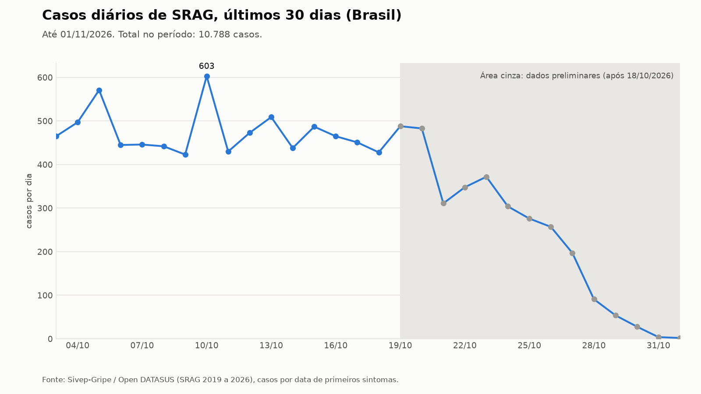
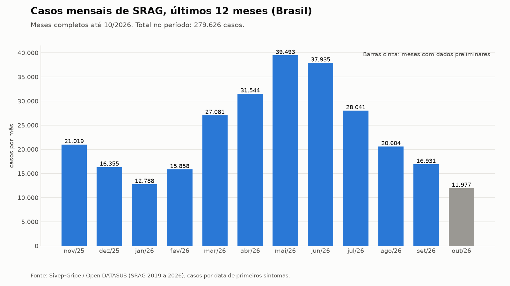

# Relatório de SRAG: Brasil, referência 01/11/2026

Síndrome Respiratória Aguda Grave (Sivep-Gripe / Open DATASUS). Métricas calculadas por código; interpretação redigida por um modelo de linguagem a partir exclusivamente desses números e validada por guardrails.

## Resumo executivo

Em 01/11/2026, os dados brutos do Sivep-Gripe mostram queda nacional de casos de SRAG: -75,5% em 7 dias (633 contra 2582) e -35,5% em 30 dias (10788 contra 16734). Esses valores são fortemente afetados pelo atraso de notificação dos últimos 14 dias. Nos dados consolidados, com janelas terminando em 18/10/2026, a variação é de -3,2% em 7 dias (3251 contra 3360) e de -14,3% em 30 dias (15451 contra 18023), e esse é o melhor ponto de referência. Entre as classificações finais, a covid-19 foi a única que subiu entre duas janelas consolidadas de 30 dias, de 255 para 348 casos, em volume ainda pequeno diante do total. Sergipe é a única das três UFs analisadas com alta consolidada em 30 dias (+10,0%). Na janela de 03/10 a 01/11, a mortalidade entre casos com desfecho conhecido é de 4,1% (191 de 4636), mas 57,0% dos casos (6152 de 10788) ainda não têm desfecho. A proporção de internados que foram para UTI é de 28,8% (2625 de 9114). Entre os casos de SRAG, 39,1% tinham vacina contra covid-19 registrada (4164 de 10662) e 39,6% tinham vacina contra gripe (4021 de 10157). As notícias de alta de SRAG são um sinal externo não verificado e ainda não confirmado de forma geral pelos dados do Sivep-Gripe.

## Métricas

| Métrica | Valor | Numerador / denominador | Janela |
|---|---:|---:|---|
| Taxa de aumento de casos (7 dias) | **-75,5%** consolidado: -3,2% | 633 / 2.582 | 26/10/2026 a 01/11/2026 |
| Taxa de aumento de casos (30 dias) | **-35,5%** consolidado: -14,3% | 10.788 / 16.734 | 03/10/2026 a 01/11/2026 |
| Taxa de mortalidade (casos com desfecho conhecido) | **4,1%** | 191 / 4.636 | 03/10/2026 a 01/11/2026 |
| Taxa de ocupação de UTI (proxy: internados que foram para UTI) | **28,8%** | 2.625 / 9.114 | 03/10/2026 a 01/11/2026 |
| Taxa de vacinação contra covid-19 entre casos de SRAG (proxy) | **39,1%** | 4.164 / 10.662 | 03/10/2026 a 01/11/2026 |
| Taxa de vacinação contra gripe entre casos de SRAG (proxy) | **39,6%** | 4.021 / 10.157 | 03/10/2026 a 01/11/2026 |

## Gráficos

## Interpretação por métrica

### Taxa de aumento de casos (7 dias)

**Variação de -75,5% em 7 dias (633 casos contra 2582), valor bruto fortemente afetado por atraso de notificação.**

A razão compara os casos com primeiros sintomas entre 26/10 e 01/11/2026 (633) com os de 19/10 a 25/10/2026 (2582). Os últimos 14 dias são preliminares, e o atraso de notificação faz o período recente parecer uma queda. Sobre dados consolidados (janela de 7 dias terminando em 18/10/2026: 3251 casos contra 3360), a variação é de -3,2%, e essa é a leitura mais confiável. A contagem usa a data de primeiros sintomas, não a de notificação.

*Definição:* Casos de SRAG com primeiros sintomas entre 26/10/2026 e 01/11/2026 (633) divididos pelos casos entre 19/10/2026 e 25/10/2026 (2582), menos 1 no Brasil.

*Ressalvas:*
- Os últimos 14 dias antes de 01/11/2026 são preliminares: o atraso de notificação faz o período recente parecer uma queda.
- Sobre dados consolidados (janela de 7 dias terminando em 18/10/2026: 3251 casos contra 3360 na janela anterior) a variação é -3,2%.
- Contagem por data de primeiros sintomas, não por data de notificação.

### Taxa de aumento de casos (30 dias)

**Variação de -35,5% em 30 dias (10788 casos contra 16734), valor bruto parcialmente artefato de notificação tardia.**

Compara os casos de 03/10 a 01/11/2026 (10788) com os de 03/09 a 02/10/2026 (16734). Os últimos 14 dias são preliminares e o atraso de notificação infla a aparência de queda. Na janela consolidada de 30 dias terminando em 18/10/2026 (15451 casos contra 18023), a variação é de -14,3%, indicando queda bem menor que a bruta. A contagem é por data de primeiros sintomas.

*Definição:* Casos de SRAG com primeiros sintomas entre 03/10/2026 e 01/11/2026 (10788) divididos pelos casos entre 03/09/2026 e 02/10/2026 (16734), menos 1 no Brasil.

*Ressalvas:*
- Os últimos 14 dias antes de 01/11/2026 são preliminares: o atraso de notificação faz o período recente parecer uma queda.
- Sobre dados consolidados (janela de 30 dias terminando em 18/10/2026: 15451 casos contra 18023 na janela anterior) a variação é -14,3%.
- Contagem por data de primeiros sintomas, não por data de notificação.

### Taxa de mortalidade (casos com desfecho conhecido)

**Mortalidade de 4,1% entre casos com desfecho conhecido (191 óbitos por SRAG de 4636 casos).**

O numerador reúne os óbitos por SRAG e o denominador reúne os casos com desfecho conhecido (cura, óbito por SRAG ou por outras causas), de 03/10 a 01/11/2026. Dos 10788 casos da janela, 6152 (57,0%) ainda não têm desfecho registrado e ficaram fora do denominador, por isso a mortalidade recente tende a ser revisada. Os óbitos por outras causas contam no denominador, mas não no numerador.

*Definição:* Óbitos por SRAG (EVOLUCAO=2, 191) divididos pelos casos com desfecho conhecido (cura, óbito por SRAG ou por outras causas, 4636) entre 03/10/2026 e 01/11/2026 no Brasil.

*Ressalvas:*
- 6152 de 10788 casos da janela (57,0%) ainda não têm desfecho registrado e ficaram fora do denominador; a mortalidade recente tende a ser revisada.
- Óbitos por outras causas (EVOLUCAO=3) contam no denominador, não no numerador.

### Taxa de ocupação de UTI (proxy: internados que foram para UTI)

**28,8% dos internados com informação de UTI foram admitidos em UTI (2625 de 9114).**

A métrica é a proporção de internados por SRAG que precisaram de UTI entre 03/10 e 01/11/2026, e não a ocupação de leitos, pois o Sivep-Gripe não informa a capacidade de UTI. Foram excluídos do denominador 1095 internados sem informação de UTI, de um total de 10209 hospitalizados. O dado recente também está sujeito a revisão por atraso de preenchimento.

*Definição:* Internados por SRAG admitidos em UTI (UTI=1, 2625) divididos pelos internados com informação de UTI (UTI=1 ou 2, 9114) entre 03/10/2026 e 01/11/2026 no Brasil.

*Ressalvas:*
- Não é ocupação de leitos: o Sivep-Gripe não informa capacidade de UTI. A métrica é a proporção de internados por SRAG que precisaram de UTI.
- 1095 internados sem informação de UTI ficaram fora do denominador.

### Taxa de vacinação contra covid-19 entre casos de SRAG (proxy)

**39,1% dos casos de SRAG com informação vacinal tinham vacina contra covid-19 registrada (4164 de 10662).**

É a proporção de vacinados entre pacientes com SRAG de 03/10 a 01/11/2026, e não a cobertura vacinal da população, pois o recorte é de casos graves e não representa a população geral. A cobertura populacional tem fonte própria (PNI/RNDS), fora do escopo deste dataset. Ficaram fora do denominador 126 casos sem informação vacinal.

*Definição:* Casos de SRAG com vacina contra covid-19 registrada (VACINA_COV=1, 4164) divididos pelos casos com informação vacinal (VACINA_COV=1 ou 2, 10662) entre 03/10/2026 e 01/11/2026 no Brasil.

*Ressalvas:*
- É a proporção de vacinados entre pacientes com SRAG, não a cobertura vacinal da população: o recorte é de casos graves e não representa a população geral. A cobertura populacional tem fonte própria (PNI/RNDS), fora do escopo deste dataset.
- 126 casos sem informação vacinal ficaram fora do denominador.

### Taxa de vacinação contra gripe entre casos de SRAG (proxy)

**39,6% dos casos de SRAG com informação vacinal tinham vacina contra gripe registrada (4021 de 10157).**

A proporção refere-se à vacina contra gripe na última campanha registrada, entre pacientes com SRAG de 03/10 a 01/11/2026, e não à cobertura vacinal da população. A cobertura populacional tem fonte própria (PNI/RNDS), fora do escopo deste dataset. Ficaram fora do denominador 631 casos sem informação vacinal, uma lacuna maior que a da vacina contra covid-19.

*Definição:* Casos de SRAG com vacina contra gripe na última campanha registrada (VACINA=1, 4021) divididos pelos casos com informação vacinal (VACINA=1 ou 2, 10157) entre 03/10/2026 e 01/11/2026 no Brasil.

*Ressalvas:*
- É a proporção de vacinados entre pacientes com SRAG, não a cobertura vacinal da população: o recorte é de casos graves e não representa a população geral. A cobertura populacional tem fonte própria (PNI/RNDS), fora do escopo deste dataset.
- 631 casos sem informação vacinal ficaram fora do denominador.

## Aprofundamento

Por classificação final, comparando casos com primeiros sintomas em 20/08 a 18/09 e em 19/09 a 18/10 (janelas consolidadas): influenza passou de 975 para 563; outro vírus respiratório, de 6400 para 4299; outro agente etiológico, de 258 para 203; não especificado, de 8204 para 6466; covid-19, de 255 para 348; sem classificação, de 1931 para 3572. A covid-19 é a única classe que subiu, mas seu volume absoluto é pequeno diante do total. O aumento de casos sem classificação indica encerramento ainda incompleto, o que limita a leitura por agente etiológico. A categoria outro vírus respiratório (4299 casos na janela mais recente) não separa os vírus, então os dados não permitem confirmar nem refutar afirmações sobre vírus específicos como metapneumovírus e rinovírus. Por UF, no crescimento em 30 dias, MS tem -34,9% bruto (291 contra 447) e -20,6% consolidado (408 contra 514). SE tem -26,9% bruto (207 contra 283) e +10,0% consolidado (287 contra 261). MG tem -42,7% bruto (1036 contra 1808) e -22,6% consolidado (1614 contra 2085). SE é a única das três UFs com alta consolidada, e sua queda bruta é em boa parte efeito do atraso de notificação. MS e MG mostram queda mesmo nos dados consolidados. A série mensal tem pico em maio de 2026, com 39493 casos, e queda desde então; outubro soma 11977 casos, valor preliminar. Os últimos dias da série diária (2 casos em 01/11 e 4 em 31/10) são claramente incompletos e não indicam queda real.

## Contexto das notícias

As notícias apontam crescimento de SRAG no país [n1][n2], enquanto a série nacional bruta mostra queda, em parte por atraso de notificação. Nos dados consolidados a queda é bem menor (-3,2% em 7 dias e -14,3% em 30 dias). O alerta de covid-19 em [n1] e [n3] é coerente com a alta dessa classificação entre as janelas consolidadas (de 255 para 348 casos), embora o dado nacional não separe etiologia de forma conclusiva nem permita confirmar os vírus citados em [n1]. O alerta de Sergipe [n4] é consistente com a alta consolidada de +10,0% em SE. Para MS [n3], os dados por UF mostram queda mesmo no consolidado (-20,6%), e o recorte por UF não separa casos graves de covid-19. As notícias de Uberaba [n5] e Uberlândia [n8] trazem contexto municipal em MG, que não foi verificado no Sivep-Gripe; MG mostra queda consolidada de -22,6%. As notícias de alta são de 05/11/2026, posteriores à data de referência (01/11/2026), e podem refletir outra metodologia e outro recorte temporal, como o boletim InfoGripe da Fiocruz. Todas são dados externos não verificados, usadas apenas como contexto e sem atribuição de números além dos que constam em seus títulos.

| Id | Data | Fonte | Título | Citada |
|---|---|---|---|:---:|
| n1 | 05/11/2026 | Rádio Itatiaia | [Brasil registra alta de SRAG por metapneumovírus, rinovírus e covid-19, alerta Fiocruz](https://news.google.com/rss/articles/CBMiuwFBVV95cUxNLThIZlBHZ3ZWd0w5QW1TRDJ5QUtianh4bUJVZU9fMlhUVDJ4dkdIOV96VjlPRklYeE12cU9hdWlncWFvLTdXa21wa1lJWk5YVGlBbk9YazN6a1NiNnBnY3JYNkFUU0xHV3VVZHRjRHd3Vk83YXVCa1RlbnV5bGxpdzdnTmJ2T0VGbW4wNTBTY096VEIxc1ZPb052ZlcxeHcyMzlkaWZzZnV6TmxrbVB6aHdRb0FiV2x5a2Jv?oc=5) | sim |
| n2 | 05/11/2026 | Agência Brasil | [Casos de síndrome respiratória aguda grave crescem no país](https://news.google.com/rss/articles/CBMizgFBVV95cUxOakRaWUNTOFo0emxwMGtkY0pJTlRqZDNUMWFiOWpnRlRWV2dscGJUX0p6bEFyX1hYVkNGdU4xUmR5UnhpOEpHakwzaWNQR2NPX0lGWlE1N3Jhc1pRMGYtb3ZyQm5TVTNmN045M090V2VJTl9YbkhyRkQ2TGdRQ2steFVyclVuTWFVQUlreUZZOHZBaUlfcm5TcmwzTGtDU0RQT0tVTG52RUsyVEt6WjQteTJFQWs2X2xMcVdFV1FIWVk1bFhqTXdkNWViRXgzQQ?oc=5) | sim |
| n3 | 05/11/2026 | Midiamax | [MS entra em alerta com aumento de casos graves de Covid, aponta Fiocruz](https://news.google.com/rss/articles/CBMiswFBVV95cUxPSVd0QXlFZlFRR2ZGOWt0QVJmTGdQQS1TTVFzYTk1UXJVcE9HWjdLcUhPSmhROHJCWmZrNjBUU0xScTNEU0I0ZFBtRXBJMDFOY1FKM0VjU2FKY3pVVDRFbzQ0eDV5TnRhU04wVC12OThCTFoyMEphbGNHb1JCa2UwLXJEcG5Oc05qZGg5SG1sSlI5MmdRcFdtQTNqY1NCNXdFMmdvcWd3MmdFVEFraVhBbWxqRQ?oc=5) | sim |
| n4 | 05/11/2026 | G1 | [Casos de Síndrome Respiratória Aguda Grave em Sergipe estão em nível de alerta, aponta InfoGripe](https://news.google.com/rss/articles/CBMijwFBVV95cUxNdkRIWjlIV2dYMkFuaGpMeDkzcHcwMU5zYXdtbkVHZzNickZLMEQxQnh4NTNTT2J1cF9vSnNZcjlVNURKeFNWLUJJQmN0eHREWUdsREdFWk5uRjhoOHhfbUxNSC1EWlpwWmpMbThwUk9XdFF6aWJTelVxeG5WdTZMYTMxMTFHWTY2SjZCYVlrb9IBngFBVV95cUxOeG8tbUV2N2hvMmNqRjBDRkp1LWpXRGdTYW5OQURxU2tjRE11TVJmVmVLZUN5M2RwYlpmMUNkbHVENERDdEtQNXlSXzJqSkZuWXRKTlBiUFlWa3VwcFRtVmRacjFpOEo1bHZHdWhKUnJuWGRORklJMGpWV294OWdaaW5YS3RhVnFXejRmUWhHUmdZUDh3dS1WRmNQMW50Zw?oc=5) | sim |
| n5 | 05/11/2026 | JM Online | [Uberaba chega a 20 mortes por SRAG e soma 694 hospitalizações em 2026](https://news.google.com/rss/articles/CBMirgFBVV95cUxOZW5hbGw4c3JtWjdNcldQcGhic3pYbXUyaTFqRVQydFhkeGxISktWRl8wd2FvUzFIM1A5RF93OEloS1VjMDJiUFhodDFmWjRhaDd3V0EyWU0yUGF0b2pjMk5XTWROc2QxSDRTM1NUSlNZMWNvdEtkMk5UNC13cWJJR2FFTDFtd3FZZ3dqQ3BZVERMaTRkcGtGTDJPODNTNHlIX3hSWWxUNDc3RnJoc3fSAbYBQVVfeXFMT19TN3VsUHB3Nnl4X21iYW5YZVFjUG1IZk1ESUwxQ1NvdkJxaVNZeXRjMVNxc1l4NUx1U2pGaldjcmxSOGxqUkhoS1JnUmNRa2t4WmJ3M19xaWdfeGNoTnI0cVd4WmV6YkJmMElqWUxuRzlZdTFNeDNYVWdCdjJPZkx6Snd1aGp3QlNfR3ZidDM4a0VsVVdSVUQ2TDU2ZlhDUUV1YnJVbUJZdHkyMVBvVlJmTkZtUXc?oc=5) | sim |
| n6 | 03/11/2026 | AM POST | [Bebê indígena de cinco meses é resgatado de helicóptero após quadro grave na Terra Yanomami](https://news.google.com/rss/articles/CBMivwFBVV95cUxOcGdyVHBLcnRvTy1JRnowbW04LV9CSFBHbVQwZk1HR0VKYTRrY05Gb1RoMjVjQ3VWOE84VWtENzFud3V0SFZuaGJFUmtKeElDa2k2LUd0amdHQzYwTl9idFZPVmt5SVRrT1Q5NlVIeXlqNHhFamxFWTZkc0RuV0FhRnpYTGNEdWdxOEcxVXF2bVVmcEZRQTl4RjFjQXRiclFnV1k1elRJQnh2NnVxM3dqbDQ5MzlpMVl3YTd5bUttaw?oc=5) |  |
| n7 | 02/11/2026 | Folha BV | [Bebê de cinco meses é resgatado de comunidade Yanomami após diagnóstico de síndrome respiratória grave](https://news.google.com/rss/articles/CBMi1wFBVV95cUxOMlZhNDhFai14WFZWT0Uzbll5MEY1YlloMkY4Zk9FNDhLY25MWmUxaEdsR1hTbVFoSFRVQ05RSjY5S1I5cmpPVUdSUmVGUHpSRWF2YmIzYkNCczRLWHBWUDVvaHRlUjhSWnNQMldweGdNZElLbVJ2NVpzTDJ4cXdHNm1kcHg4RTByeUtzX04wbGhtN1VEWE9OdDFETEtxZVBENGdoUlQ1QnVmbXBlNmgwUUprcXZFNnlQUUhRcTFhdXJhVG5qR1R3VGNjNllVek9rN0d4OUFqNA?oc=5) |  |
| n8 | 31/10/2026 | Diário de Uberlândia | [Uberlândia registra uma morte a cada três dias por síndrome respiratória grave](https://news.google.com/rss/articles/CBMixAFBVV95cUxQRlBSbTVfNEVleXNSRUlpNmh4RWxHMHhrUC0wU2JOcHA5YlhTWHF3ZEpNUGwxSXU2a1hDUUlKZFBCNmJVY3d0S2NUYkY2czhickF6dzdDNFdNN2psMmlBaXlvOHF5eVp6X0x0aUhRYldwUS1famxuV21oVWlNRE15c1NyTDNEcmVndWpVZ0xBY3NMam12VUtjSkVwaDVIc2FfMmpKNHlTTXV0TjBXamMtTG5PdTJ4M1BsaFVQempnRVVXeF96?oc=5) | sim |

## Limitações

- Os últimos 14 dias antes de 01/11/2026 são preliminares por atraso de notificação; as variações brutas de 7 e 30 dias superestimam a queda, e o consolidado é a melhor referência.
- A contagem de casos usa a data de primeiros sintomas, não a de notificação.
- A mortalidade exclui casos sem desfecho: 6152 de 10788 casos (57,0%) ficaram fora do denominador, e o valor tende a ser revisado.
- A taxa de UTI é a proporção de internados com informação de UTI que foram admitidos em UTI, não a ocupação de leitos; 1095 internados sem informação de UTI foram excluídos.
- As taxas de vacinação são proporções entre pacientes com SRAG, não cobertura populacional; 126 casos (covid-19) e 631 casos (gripe) sem informação vacinal foram excluídos.
- A classificação final está incompleta: casos sem classificação passaram de 1931 para 3572 entre as janelas consolidadas. A categoria outro vírus respiratório não separa os vírus, o que impede avaliar metapneumovírus e rinovírus.
- A análise por UF cobriu apenas MS, SE e MG; os dados por município (Uberaba e Uberlândia) não foram verificados no Sivep-Gripe.
- As notícias são dados externos não verificados, coletados automaticamente, e a maioria é posterior à data de referência; servem apenas como contexto e não comprovam tendências.

## Como este relatório foi produzido

- **Execução:** `8e0cceae`, gerada em 06/11/2026 00:04 UTC por `srag-report-agent 0.1.0`.
- **Dados:** `data/processed/srag.parquet` (SHA-256 `379957b636915230…`), Sivep-Gripe/Open DATASUS, último caso em 2026-11-01. Dados de-identificados: sem nomes, documentos, datas de nascimento, município ou texto livre.
- **Modelo:** `claude-sonnet-5-5`, 3 chamada(s), 25.701 tokens de entrada e 8.046 de saída.
- **Ferramentas:** métricas e séries calculadas por código antes do modelo, mais 4 chamada(s) de ferramenta pedida(s) pelo modelo; todos os números vêm de SQL determinístico sobre DuckDB, nunca do modelo.
- **Notícias:** google_news_rss; consultas: SRAG síndrome respiratória aguda grave, síndrome respiratória aguda grave internações, vírus respiratório hospitalizações Brasil.
- **Auditoria completa:** `audit/exemplo/run-20261106T000314Z-8e0cceae.jsonl` (JSONL com cada chamada, decisão e guardrail).
- **Guardrails executados:**
  - `sql_guard`: ok
  - `report_structure`: ok
  - `metric_caveats`: ok
  - `clinical_advice`: ok
  - `pii`: ok
  - `numeric_consistency`: ok
  - `output_validation`: ok
- **Validação final da saída:** aprovada (all_metrics_commented=ok, summary_length=ok, news_citations_valid=ok, language_pt_br=ok, limitations_present=ok, caveats_present=ok, no_clinical_advice=ok, no_pii=ok, numeric_consistency=ok).
